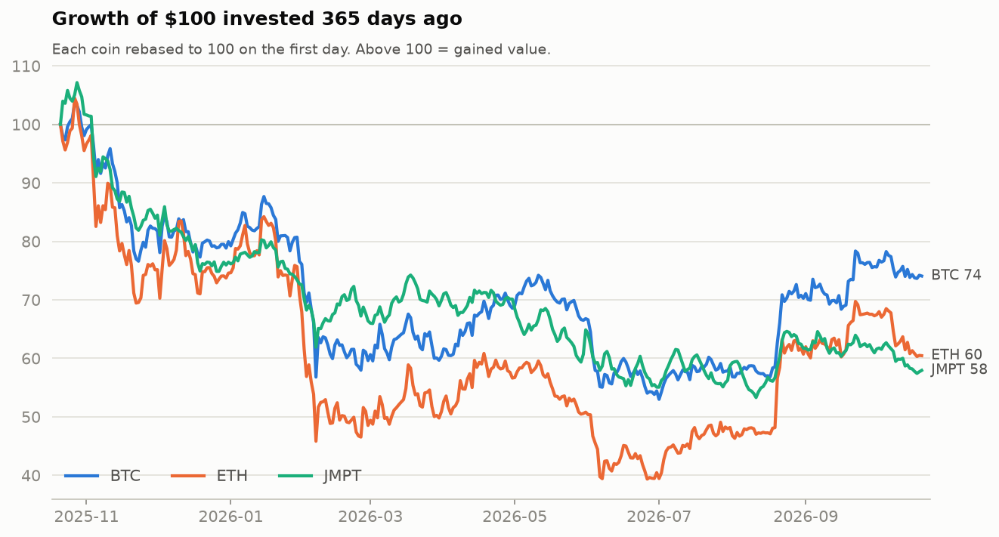
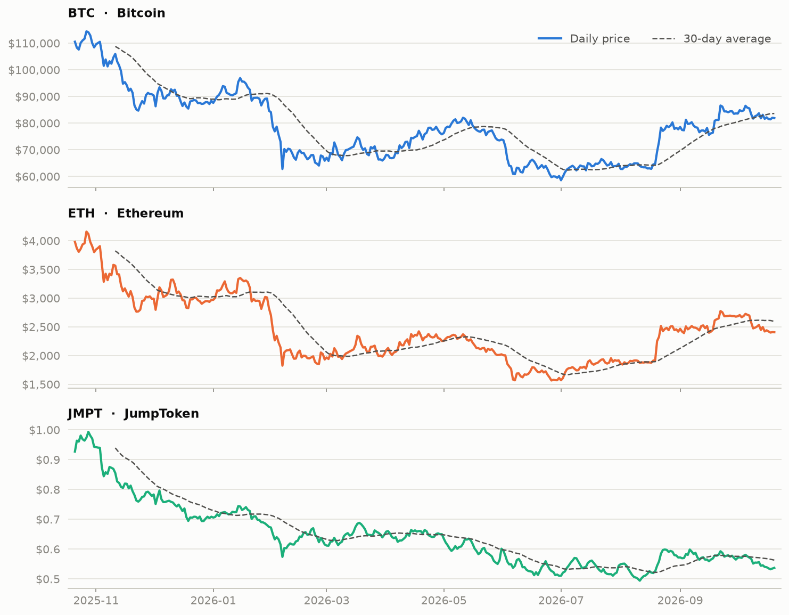
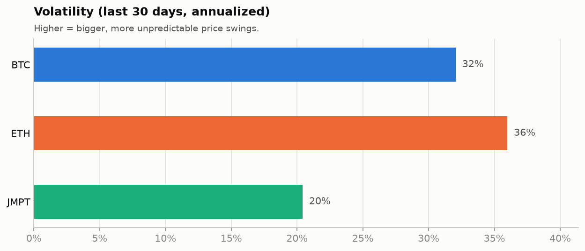

# Crypto Market Tracker


An automated data pipeline that collects daily market data for **Bitcoin (BTC)**, **Ethereum (ETH)** and **JumpToken (JMPT)** from the [CoinGecko API](https://www.coingecko.com/en/api), stores it as a growing CSV dataset, and rebuilds the charts and stats on this page every day with GitHub Actions.

The project compares two of the largest cryptocurrencies with a small-cap token: how differently do they perform over time, and is the smaller token really the more volatile one?

## Latest stats

<!-- STATS:START -->
_Snapshot as of **2026-10-20 00:00 UTC**. Updated automatically every day._

| Coin | Price | 1 day | 7 days | 30 days | 1 year | Volatility (30d) | Market cap |
|:--|--:|--:|--:|--:|--:|--:|--:|
| **BTC** Bitcoin | $81,875 | ▼ -0.2% | ▲ +0.1% | ▲ +0.8% | ▼ -24.6% | 32% | $1.65T |
| **ETH** Ethereum | $2,406 | ▼ -0.1% | ▼ -1.6% | ▼ -8.6% | ▼ -39.6% | 36% | $293.88B |
| **JMPT** JumpToken | $0.537 | ▲ +0.4% | ▼ -1.3% | ▼ -7.0% | ▼ -42.3% | 20% | $7.93M |
<!-- STATS:END -->

## Charts

### Performance


### Price and 30-day moving average


### Volatility


## How it works

```
GitHub Actions (daily, 01:30 UTC)
  └─ python -m tracker
       ├─ fetch.py    → CoinGecko API → data/history.csv  (backfills 1 year, then fills any missing days)
       ├─ analyze.py  → returns, moving averages, volatility
       ├─ charts.py   → charts/*.png
       └─ readme.py   → stats table in this README
  └─ commits the updated data and charts
```

- **Weekly insight report:** every Monday at 06:00 WAT, a second workflow ([`weekly-post.yml`](.github/workflows/weekly-post.yml)) summarizes the week (best and worst performer, biggest single-day move, calmest coin), writes a post draft to [`posts/latest.md`](posts/latest.md) with a 7-day chart, and opens a GitHub issue as a reminder to share it.
- **Incremental and self-healing:** each run fetches only the days that are missing, so a skipped day is filled in on the next run.
- **Consistent snapshots:** every row is the market state at 00:00 UTC, so days are directly comparable.
- **Tested:** the metric calculations and data merging are covered by `pytest`, and the tests run before every update.

## Metrics explained

| Metric | Meaning |
|:--|:--|
| **Price** | Value of one coin in US dollars |
| **Market cap** | Price × coins in circulation, the overall size of the coin |
| **% change** | Price now vs. 1, 7, 30 or 365 days ago |
| **30-day moving average** | Average price over the previous 30 days. It smooths out daily noise to show the trend |
| **Volatility (30d)** | Standard deviation of daily log returns over 30 days, scaled to a year (× √365). Higher means bigger price swings |
| **Growth of $100** | Each coin rebased to 100 on the first day so coins with very different prices share one chart |

## Dataset

[`data/history.csv`](data/history.csv) has one row per coin per day:

| Column | Description |
|:--|:--|
| `date` | UTC date of the snapshot |
| `coin` | CoinGecko coin ID |
| `price_usd` | Price in USD |
| `market_cap_usd` | Market capitalization in USD |
| `volume_usd` | 24-hour trading volume in USD |

## Run it locally

```bash
python -m venv .venv
source .venv/bin/activate        # Windows: .venv\Scripts\activate
pip install -r requirements.txt
python -m pytest -q              # run the tests
python -m tracker                # fetch data, rebuild charts and README
```

To track different coins, edit [`config.json`](config.json) using the coin IDs shown in CoinGecko URLs (e.g. `coingecko.com/en/coins/solana` → `solana`). New coins are backfilled automatically.

An API key is optional. The public API works without one. For higher rate limits, create a free Demo key at [CoinGecko](https://www.coingecko.com/en/api/pricing) and add it as a repository secret named `COINGECKO_API_KEY`.

## Tech stack

Python · pandas · NumPy · Matplotlib · Requests · pytest · GitHub Actions

---

Data provided by [CoinGecko](https://www.coingecko.com). This is a data analysis project, not financial advice.
